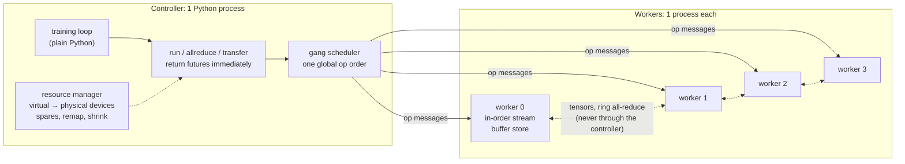
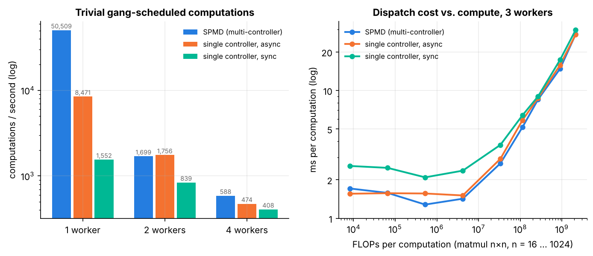
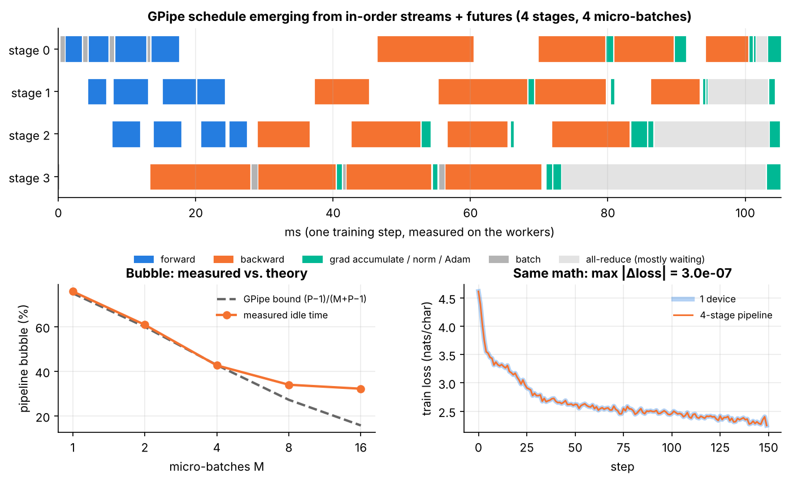
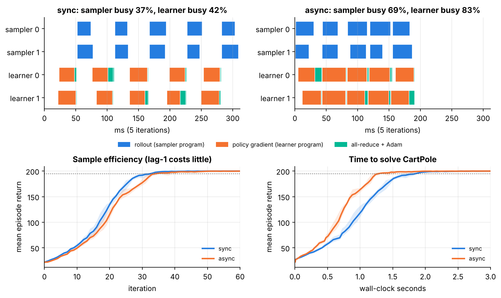

# minipath

A single-controller runtime for distributed training, written from scratch
in about 1,100 lines of Python. It's my attempt to understand Google's
[Pathways](https://developers.googleblog.com/what-is-pathways-single-controller-training-for-large-models/)
by rebuilding the core ideas and measuring them on real workloads.

One Python process drives every worker. It dispatches compiled JAX programs
as futures, gang-schedules collectives, moves tensors worker-to-worker, and
when a worker dies, re-plans the job onto a spare without restarting it.


<sub>Left: a data-parallel transformer run on Tiny Shakespeare. Worker 2 is
SIGKILLed after step 130. Right: the recovered run's loss curve matches a
failure-free run bit for bit, until a second kill with no spare left forces
an elastic shrink from 4 to 3 replicas.</sub>

## Results

Every number below comes from a script in [`experiments/`](experiments/) on
a 4-core CPU machine. Raw output is in [`results/`](results/).

| Question | Result |
|---|---|
| **What does a single controller cost?** (E1) | On 4 workers, async dispatch runs trivial all-reduce chains at **E1_ASYNC4/s vs E1_SPMD4/s** for SPMD. A controller that waits on every op (RPC style) gets E1_SYNC4/s. Once an op does ≥ ~10 MFLOPs of work, the three are indistinguishable. |
| **Why does it need a gang scheduler?** (E2) | Two clients sharing 4 workers deadlocked in **E2_UNSCHED of 20 trials** without one, and **0 of 20** with one. |
| **Can one controller drive an MPMD pipeline?** (E3) | A 4-stage GPipe transformer matches single-device training to **E3_DIFF** in loss. The measured bubble tracks the (P−1)/(M+P−1) bound: E3_BUBBLE4 measured vs 43% theory at M=4. |
| **What does a failure cost?** (E4) | Single controller with a hot spare: progress resumed **E4_SC_DOWN s** after the kill, with **E4_SC_REDO steps** redone. SPMD with checkpoint/restart: **E4_SP_DOWN s** and **E4_SP_REDO steps**. |
| **Does overlapping RL sampling and training help?** (E5) | Moving one line of the controller's Python makes rollouts for step k+1 overlap the update for step k: **E5_SPEEDUP× faster** per iteration, and CartPole is solved in the same number of iterations. |

## Why this exists

Most large-model training today is **SPMD, multi-controller**. Every host
runs the same Python program in lockstep, and the hosts coordinate only
through collectives (PyTorch DDP/FSDP under `torchrun`, multi-controller JAX).
That design is simple and fast, but three things get awkward:

1. **Failures.** One lost host stalls every peer inside an all-reduce. The
   standard fix is to kill the whole job and restart from the last
   checkpoint. The Gemini 2.5 report says training was interrupted
   ["multiple times per hour"](https://arxiv.org/abs/2507.06261).
2. **Different programs on different devices.** Pipeline stages run
   different code. RL post-training runs a sampler, a reward model and a
   learner. Under SPMD you encode all of that as rank-dependent `if`
   branches in one program.
3. **One view of the whole job.** No single process knows what is queued
   where.

Pathways flips the model. A single client builds the computation as a graph
of compiled SPMD blocks (nodes) joined by tensors (edges) placed on
*virtual* devices. A resource manager maps virtual devices to physical
chips, a central scheduler gives every op one global order, and dispatch is
asynchronous over futures, so the client stays off the critical path.

minipath implements each of those pieces small enough to read in an
afternoon, then checks the claims with experiments.

## How it works



* **Programs** are plain JAX functions. `cluster.compile(fn)` pickles one,
  and each worker `jax.jit`s it the first time it runs there.
* **`run`, `allreduce` and `transfer` return futures** (`Sharded`, one
  buffer id per rank) before any work happens. You chain futures the way you
  would chain arrays.
* **Every worker has one in-order stream**, like a CUDA stream or a TPU
  core. An op whose input hasn't arrived blocks the stream. That is what
  makes gang scheduling necessary, and it is how pipelines emerge without
  hand-written synchronization.
* **The controller is never on the data path.** Transfers and collectives
  go worker to worker. Transfers run beside the compute stream, the way a
  DMA engine does.
* **Failures fence by epoch.** On a worker loss, the controller bumps the
  epoch and sends an out-of-band abort, which unblocks survivors stuck in a
  collective. It then refuses dispatch until the client re-plans.

[`docs/DESIGN.md`](docs/DESIGN.md) maps each Pathways concept to the code
and lists what is deliberately left out.

### The API in one example

```python
import numpy as np
from minipath import Cluster

def loss_and_grad(params, x, y): ...   # any jittable JAX function
def adam(params, m, v, g, t): ...

with Cluster(4, n_spares=1) as cluster:        # 4 workers + 1 hot spare
    dp = cluster.allocate(4)                   # a slice of virtual devices
    lg = cluster.compile(loss_and_grad, n_out=2)
    opt = cluster.compile(adam, n_out=4)
    p, m, v, t = (cluster.put(a, dp) for a in (params, zeros, zeros, np.float32(0)))

    for step in range(1000):                   # this loop never waits on compute
        x, y = next_batch(step)                # (in the experiments, batches are made on-device)
        loss, g = cluster.run(lg, dp, p, x, y)
        g = cluster.allreduce(g)               # ring all-reduce, gang-scheduled
        p, m, v, t = cluster.run(opt, dp, p, m, v, g, t)

    print(loss.fetch(0))                       # the only place the controller blocks
```

## Experiments

Each script takes `--quick` for a smoke-sized run. `make experiments` runs
them all (about 50 minutes, one at a time, since they are timing
benchmarks).

### E1. The cost of a single controller

[`experiments/e1_dispatch.py`](experiments/e1_dispatch.py). This is a
scaled-down version of the Pathways paper's dispatch micro-benchmark
(Barham et al. 2022, §5.1). The workload is a chain of trivial
gang-scheduled computations, each a program plus an all-reduce, and each one
consumes the previous one's output. It runs three ways: SPMD (every worker
runs the loop itself), a single controller that waits on each op, and a
single controller that dispatches ahead on futures.



E1_TEXT

### E2. Why a central gang scheduler

[`experiments/e2_gang.py`](experiments/e2_gang.py). Two clients share 4
workers and each issues a chain of all-reduces. Each worker runs ops in
arrival order. If worker 0 sees A's all-reduce first and worker 1 sees B's
first, each waits in a collective the other will never join. Deadlocks are
detected by a 2 s stall timeout, so they are measured, not assumed.


E2_TEXT

### E3. An MPMD pipeline from a Python loop

[`experiments/e3_pipeline.py`](experiments/e3_pipeline.py). A 4-layer,
0.8M-parameter transformer is cut into 4 stages on 4 workers. Stage 0
embeds, stage 3 fuses the head, loss and first backward step, and every
stage runs different programs. The controller's GPipe schedule is two
nested loops over futures. Stage-to-stage activations and gradients are
point-to-point transfers. Gradient clipping needs the norm over all stages,
so it is computed with one all-reduce across the four stage workers, even
though each runs a different program.



E3_TEXT

### E4. Killing a worker mid-training

[`experiments/e4_fault_tolerance.py`](experiments/e4_fault_tolerance.py).
Data-parallel training of the same transformer on Tiny Shakespeare: 4
replicas, global batch 128 × 64 characters, 400 steps. A worker is
`SIGKILL`ed after step 130.

* **SPMD baseline.** This is the usual DDP shape: 4 processes run the same
  loop, and rank 0 checkpoints every 50 steps. When a rank dies its peers
  stall in the all-reduce, so the launcher tears down the job, starts 4
  fresh processes and resumes from the last checkpoint. Detection is
  instant here, which is generous to SPMD.
* **Single controller.** It sees the failure, aborts in-flight work, and
  remaps the lost virtual device onto a hot spare. It then asks survivors
  which recent optimizer states they still hold in memory, copies the newest
  one to the spare worker-to-worker, and re-dispatches from there. A second
  kill after step 280 finds no spare, so the job shrinks to 3 replicas and
  keeps going.

E4_TEXT

### E5. RL with overlapping sampler and learner

[`experiments/e5_rl_overlap.py`](experiments/e5_rl_overlap.py). This is the
RL post-training shape from the blog: a sampler program (2 workers
running 512 CartPole environments, written in JAX) and a learner program
(2 data-parallel workers, REINFORCE with a per-timestep baseline), with
weights flowing back after each update. The two schedules differ in where
one line sits. *sync* samples with θ<sub>k</sub> and then trains. *async*
dispatches the rollout for step k+1 before the update for step k, so the
two overlap and the policy lags by one step.



E5_TEXT

## What I learned building it

* **The single controller costs latency, not throughput.** Its per-op
  Python cost (~50 µs here) is real. A synchronous controller pays it on
  every step, plus a round trip. An asynchronous one pays it in parallel with
  device work, so it disappears once ops are bigger than the dispatch cost.
  Futures are the whole trick.
* **In-order device streams are what make ordering a correctness issue.**
  The gang scheduler isn't an optimization. Without it, the shared-device
  case deadlocks. I didn't believe how fast until E2.
* **Transfers must not sit in the compute stream.** My first version queued
  `send` ops in the source worker's stream. In E5, the batch for step k then
  waited behind the rollout for step k+1, which was itself waiting for new
  weights, and the "async" schedule ran at sync speed. Moving transfers
  beside the stream, the way DMA engines sit beside compute, took the
  iteration from 66 ms to 47 ms.
* **Determinism turns recovery into a correctness test.** Batches are a
  function of (step, rank) and the ring all-reduce is bit-identical on every
  rank. So "did recovery work?" has an exact answer: the losses match a
  clean run to the last bit.
* **Localhost TCP lies to you.** The first sync benchmark ran at 23 steps/s
  because of Nagle's algorithm plus delayed ACKs. Unix sockets fixed it
  (~2,000 steps/s).

## Limitations

This is a teaching-scale reconstruction, not a production system. Read the
numbers with these in mind:

* **Everything runs on one 4-core machine.** "Workers" are processes and
  "interconnect" is Unix sockets at ~330 MB/s. There is no 100× gap between
  ICI and DCN bandwidth as on TPU pods, so none of the placement problems
  that gap creates show up here.
* **The controller shares those 4 cores with the workers.** On Pathways it
  runs on its own CPU host. E1 part B uses 3 workers for this reason.
* **There is no compiler-level sharding.** A Pathways node is a GSPMD
  program spanning many chips. Here it is one `jax.jit` per worker, and
  sharding is explicit in user code.
* **The SPMD baseline in E4 gets instant failure detection and restarts on
  the same machine**, which makes it look better than a real job (NCCL
  timeouts, rescheduling, image pulls). On the other side, torchrun-style
  elastic agents can also use hot spares. The gap here comes mostly from
  re-doing steps since the last checkpoint and from cold-starting processes.
* **The controller is a single point of failure**, as it is in Pathways.
* **E5's utilization numbers are inflated** when all four workers and the
  controller compete for four cores, because ops simply take longer.

## Where this sits among real systems

| System | Model | Notes |
|---|---|---|
| PyTorch DDP / FSDP, multi-controller JAX | multi-controller SPMD | Every process runs the same program. Failures mean restart from a checkpoint (torchrun elastic can re-rendezvous). |
| [Pathways](https://arxiv.org/abs/2203.12533) (Google) | single controller over compiled SPMD blocks, gang-scheduled per island | Reports ~100% accelerator utilization for SPMD on 2048 TPUs, and SPMD-level throughput for 16-stage pipelines. Generally available on Google Cloud as of 2026. |
| [Ray](https://www.ray.io/) | single driver over tasks and actors | The Pathways blog puts it well: Ray's job is orchestration, Pathways' job is execution. The training *inside* a Ray worker group is still SPMD. |
| [PyTorch Monarch](https://pytorch.org/blog/introducing-pytorch-monarch/) (Meta) | single controller over process/actor meshes, Rust backend | The closest open-source analogue in the PyTorch world. It fails fast by default and lets you handle failures in Python. |
| [verl / HybridFlow](https://arxiv.org/abs/2409.19256) (ByteDance) | hybrid: single controller *between* models, multi-controller *within* each | Built for RLHF. Reports 1.53–20.57× throughput over prior RLHF systems. E5 is a tiny version of this split. |
| **minipath** | single controller over per-worker jitted programs | ~1,100 lines, for reading and measuring. |

## Reproduce

```bash
git clone https://github.com/Gauravkarthikeyan/rl-poster && cd rl-poster
pip install -e ".[dev]"          # jax, numpy, cloudpickle, matplotlib, pytest
pytest -q                        # 20 tests, ~40 s
make quick                       # every experiment at smoke size, ~8 min
make experiments                 # full runs + figures, ~50 min
```

Tiny Shakespeare (1.1 MB) downloads on first use and is checked against a
SHA-256.

## Layout

```
minipath/
  controller.py      Cluster: dispatch, futures, gang scheduler, failure fencing
  worker.py          worker process: in-order stream, buffer store, ring all-reduce
  resources.py       virtual devices, slices, spares, remap, elastic shrink
  workloads/
    transformer.py   char-level transformer in plain JAX, splittable into stages
    shakespeare.py   dataset download + checksum
    cartpole.py      CartPole dynamics + REINFORCE in JAX
experiments/         E1–E5 and plots.py (every figure is generated from results/*.json)
tests/               runtime semantics + workload correctness (pipeline == 1 device,
                     recovery == clean run, physics == closed form)
docs/DESIGN.md       how each Pathways idea maps to the code, and what's left out
```

## References

* Barham et al., [*Pathways: Asynchronous Distributed Dataflow for ML*](https://arxiv.org/abs/2203.12533), MLSys 2022.
* Google Developers Blog, [*What is Pathways? Single-controller training for large models*](https://developers.googleblog.com/what-is-pathways-single-controller-training-for-large-models/), 2026.
* Huang et al., [*GPipe*](https://arxiv.org/abs/1811.06965), NeurIPS 2019.
* Sheng et al., [*HybridFlow: A Flexible and Efficient RLHF Framework*](https://arxiv.org/abs/2409.19256), EuroSys 2025.
* [Introducing PyTorch Monarch](https://pytorch.org/blog/introducing-pytorch-monarch/), PyTorch blog, 2025.
* Gemini Team, [*Gemini 2.5*](https://arxiv.org/abs/2507.06261) technical report, 2025.
* Barto, Sutton & Anderson, *Neuronlike adaptive elements that can solve difficult learning control problems*, 1983 (CartPole).
* Karpathy, [char-rnn](https://github.com/karpathy/char-rnn) (Tiny Shakespeare).

## License

MIT
